# Implementación de OpenTelemetry en Microservicios

**Integrantes:** Juan Camilo Muñoz Barco y Martin Gomez Caicedo
**Repositorio:** https://github.com/Electromayonaise/service-discovery-circuit-breaker

Este informe documenta la instrumentación con OpenTelemetry de los microservicios `fx-course-service`
(FutureXCourseApp) y `fx-catalog-service` (FutureXCourseCatalog) mediante tres enfoques, siguiendo el enunciado y
las guías de esta carpeta. Para cada parte se presentan los pasos, la evidencia solicitada y los problemas
encontrados con su solución.

## Contexto y organización del trabajo

Los servicios provienen del taller anterior: `fx-catalog-service` descubre a `fx-course-service` a través de
Eureka (`fx-discovery-server`) y protege sus llamadas con Resilience4j (Circuit Breaker, Retry y fallbacks). Todo
el sistema se ejecuta con Docker Compose, por lo que Jaeger y el Collector se agregaron como servicios del mismo
`docker-compose.yml`, y los endpoints de exportación se parametrizaron para funcionar tanto dentro de la red de
Compose como en ejecución local.

Cada enfoque se desarrolló en una rama propia:

| Parte | Enfoque | Rama | Base | Envío de trazas |
|---|---|---|---|---|
| 1 | Agente Java de OpenTelemetry | `otel-agente-java` | `main` | Aplicación → Jaeger |
| 2 | API/SDK de OpenTelemetry | `otel-api` | `main` | Aplicación → Jaeger |
| 3 | API/SDK + OpenTelemetry Collector | `otel-colector` | `otel-api` | Aplicación → Collector → Jaeger |

Las guías 1 y 2 son alternativas independientes; la guía 3, en cambio, modifica la configuración de la guía 2
("Ensure your pom.xml has the necessary OpenTelemetry dependencies from the previous exercise", "Update your
OpenTelemetryConfig class"). Por eso `otel-colector` parte de `otel-api`. La rama `otel-colector` es la que se
integró en `main` (ver [Comparación de los enfoques](#comparación-de-los-enfoques)).

Versiones utilizadas: Spring Boot 3.3.3, Spring Cloud 2023.0.3, agente Java 2.32.0,
`opentelemetry-instrumentation-bom` 2.6.0 (SDK 1.40.0), Jaeger `all-in-one` 1.76.0 y
`otel/opentelemetry-collector` 0.88.0.

---

## Parte 1: Agente Java de OpenTelemetry

Rama: `otel-agente-java`.

### 1. Descarga del agente

El agente (`opentelemetry-javaagent.jar`, v2.32.0) se obtiene de dos formas: el `Dockerfile` de cada servicio lo
descarga durante la construcción de la imagen, y el script `scripts/download-otel-agent.sh` lo deja en la raíz del
repositorio para la ejecución local. El `.jar` no se versiona (está en `.gitignore`). La versión se fijó, en lugar
de usar `latest`, para que las imágenes sean reproducibles.

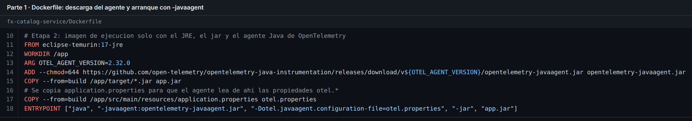

### 2. Modificación de `application.properties`

Se agregaron en ambos servicios las propiedades de la guía: exportación de trazas por OTLP/gRPC a
`http://localhost:4317` y exportadores de métricas y logs deshabilitados.

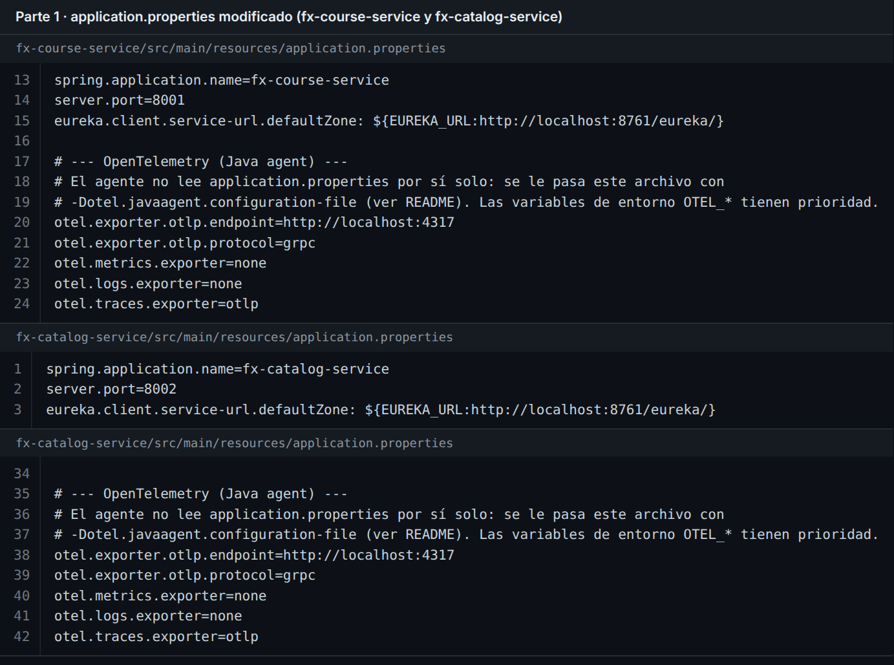

### 3. Jaeger con Docker Compose

Se agregó al `docker-compose.yml` el servicio `jaeger` de la guía (`jaegertracing/all-in-one`, con la UI en el
puerto 16686 y los receptores OTLP en 4317/4318). Los servicios instrumentados dependen de él y reciben
`OTEL_EXPORTER_OTLP_ENDPOINT=http://jaeger:4317`.

### 4. Ejecución con el agente

Las imágenes arrancan con
`java -javaagent:opentelemetry-javaagent.jar -Dotel.javaagent.configuration-file=otel.properties -jar app.jar`.
En el log de ambos servicios aparece la versión del agente antes del arranque de Spring Boot.

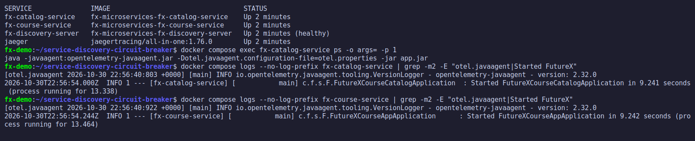

### 5. Trazas en Jaeger

Sin modificar el código Java, el agente instrumenta Tomcat, el cliente HTTP, Spring Data, Hibernate y JDBC, y
propaga el contexto con W3C Trace Context. Una petición a `/catalog` produce una única traza con 7 spans en dos
servicios: la petición entrante al catálogo, la llamada HTTP saliente, la petición entrante al servicio de cursos,
el repositorio y las consultas SQL.

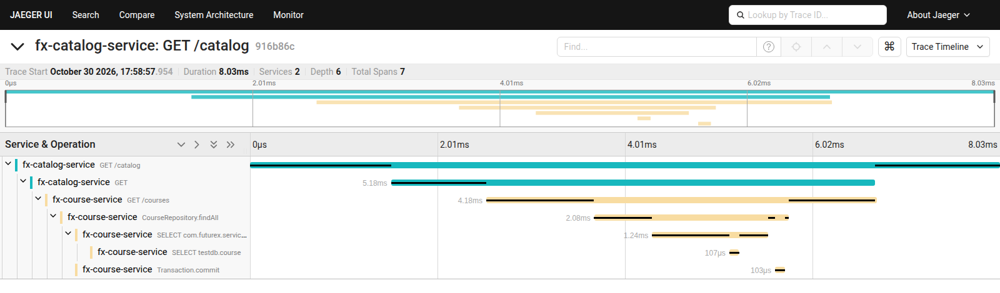

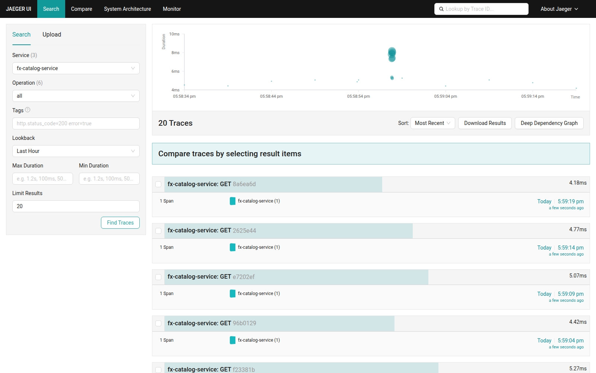

### Problemas encontrados y soluciones

- **El agente no lee `application.properties`.** Las propiedades `otel.*` de ese archivo solo las lee el starter
  de Spring Boot, no el agente, que sin más configuración usa sus valores por defecto (OTLP por HTTP al puerto
  4318). Se comprobó levantando Jaeger con solo el puerto 4317 expuesto. *Solución:* pasar el mismo archivo al
  agente con `-Dotel.javaagent.configuration-file`. Con esa opción las trazas llegaron por gRPC al 4317.
- **`localhost` dentro de Docker.** Dentro de un contenedor, `localhost:4317` no es Jaeger. *Solución:* la
  variable `OTEL_EXPORTER_OTLP_ENDPOINT=http://jaeger:4317` en Compose. Se verificó que las variables de entorno
  tienen prioridad sobre el archivo de configuración: con un endpoint inválido en la variable, no llegó ninguna
  traza.
- **Ruido del cliente de Eureka.** El agente también instrumenta las consultas del cliente de Eureka al registro
  (`GET /eureka/apps/delta`, cada 5 s en el catálogo), que aparecen como trazas de un solo span `GET` y llenan la
  búsqueda (captura anterior). Esas llamadas y las del catálogo al servicio de cursos usan la misma biblioteca
  (Apache HttpClient 5, instrumentación `apache-httpclient-5.0`), por lo que no es posible desactivar una sin
  perder la otra. *Solución:* en Jaeger se filtra por operación (`GET /catalog`, `GET /firstcourse`, `GET /`).

---

## Parte 2: API de OpenTelemetry

Rama: `otel-api`.

### 1. Dependencias en `pom.xml`

En ambos servicios se importó el BOM `opentelemetry-instrumentation-bom` 2.6.0 antes del de Spring Cloud y se
agregó `opentelemetry-spring-boot-starter`. El BOM fija el SDK en 1.40.0, por encima de la versión que gestiona
Spring Boot 3.3.3.

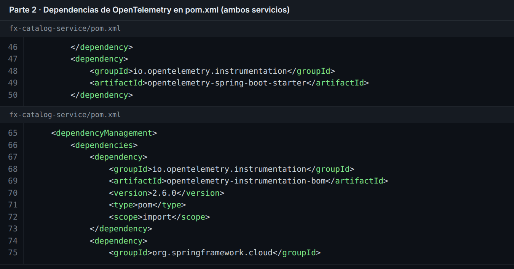

### 2. Clase `OpenTelemetryConfig`

La clase construye el SDK: un `Resource` con `service.name` igual a `spring.application.name`, un
`OtlpGrpcSpanExporter`, un `BatchSpanProcessor` y, como indica la guía, propagadores `noop`. Además expone un
`Tracer`. El endpoint del exportador se lee de `otel.exporter.otlp.endpoint` (por defecto
`http://localhost:4317`), en lugar de estar fijo en el código, para que en Compose pueda apuntar a `jaeger:4317`.

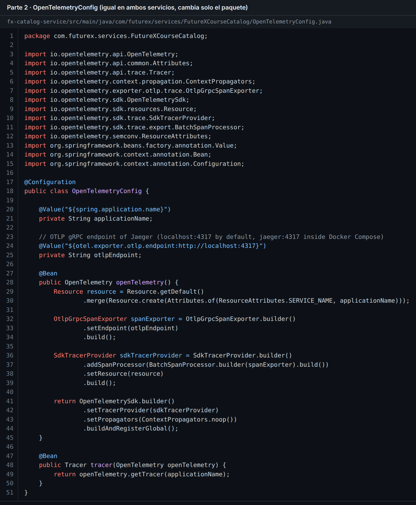

### 3. Clases principales

Ambas clases principales declaran el bean `RestTemplate`. En el catálogo, el bean que antes estaba en
`Resilience4JConfig` se trasladó a la clase principal conservando los timeouts de conexión (2 s) y lectura (3 s),
que el Circuit Breaker necesita para detectar un servicio colgado.

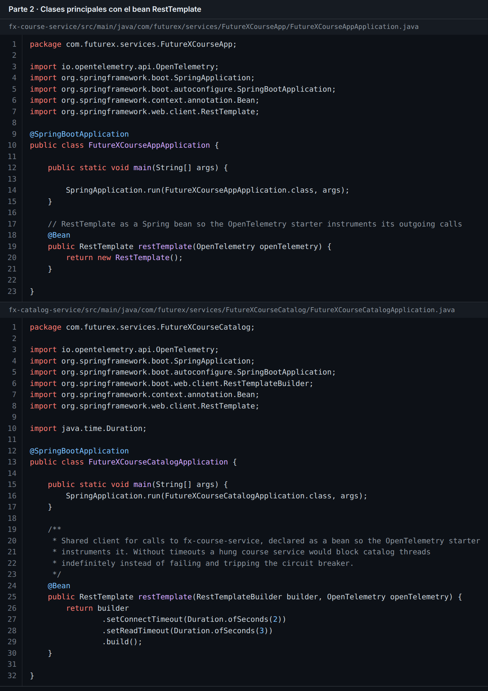

### 4. Controladores

Los endpoints crean spans manuales con el `Tracer` (`getCourseAppHome`, `getCourses`, `getSpecificCourse`,
`getCatalog`, `getCatalogHome`, `getSpecificCourse`, `getCatalogWithFactory`). A diferencia de la guía, el span se
activa con `span.makeCurrent()`, se registra la excepción y se marca el estado `ERROR` cuando la operación falla.
En el catálogo se conservaron el descubrimiento por Eureka, `@CircuitBreaker`, `@Retry` y los fallbacks; los
fallbacks agregan un evento `fallback` con la causa al span de la petición.

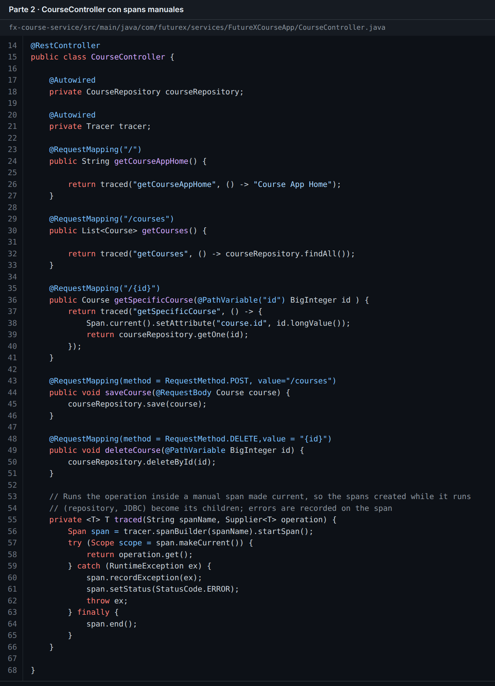

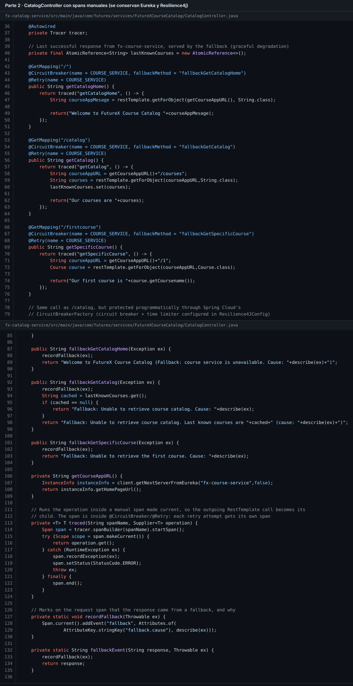

### 5. Trazas en Jaeger

Cada traza del catálogo contiene el span del servidor (`GET /catalog`, creado por el starter), el span manual
`getCatalog` y, como hijo de este, la llamada HTTP saliente. Del lado del servicio de cursos ocurre lo mismo con
`getCourses`, la conexión y la consulta SQL.

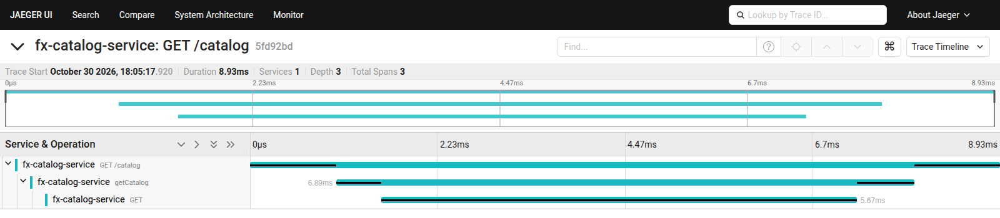

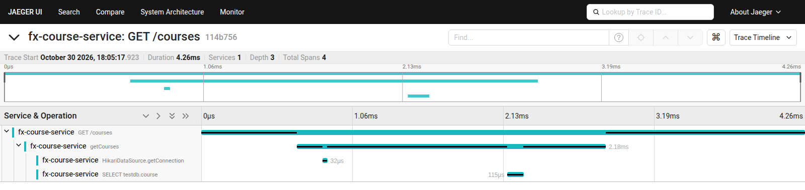

Con `ContextPropagators.noop()` el catálogo no envía la cabecera `traceparent`, por lo que la misma petición
produce **dos trazas independientes**, una por servicio: las capturas anteriores corresponden a la misma petición
(18:05:17.920 y 18:05:17.923), pero cada traza tiene un solo servicio. La búsqueda lo confirma: todas las trazas
de `GET /catalog` contienen únicamente spans de `fx-catalog-service`.

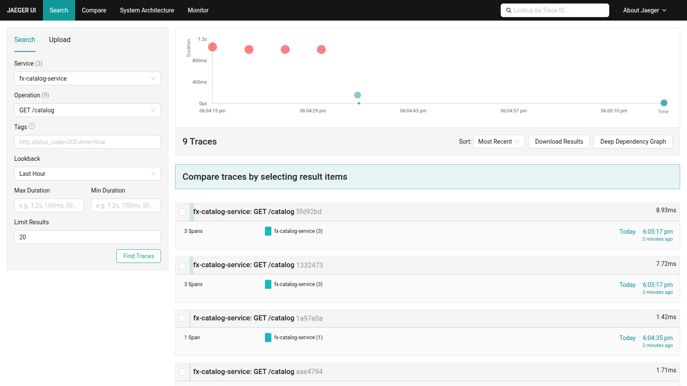

Como el span manual está dentro de los aspectos de Resilience4j, cada reintento genera su propio span. La
siguiente traza, de una petición hecha mientras el servicio de cursos aún no estaba registrado en Eureka, muestra
los tres intentos fallidos separados por 500 ms (`waitDuration` del Retry), marcados con error:

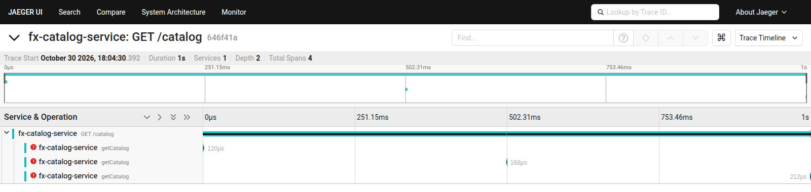

### Problemas encontrados y soluciones

- **El controlador de la guía elimina Eureka y Resilience4j.** La guía reemplaza el descubrimiento por una URL
  fija (`course.service.url`) y no incluye las anotaciones de Resilience4j. *Solución:* se instrumentó el
  controlador existente, conservando ambos patrones del taller anterior.
- **Spans sin relación con el resto de la traza.** En la guía, los spans se crean con `startSpan()` pero no se
  activan, por lo que no son padres de las llamadas que ocurren dentro de ellos. *Solución:* `makeCurrent()` en un
  bloque `try-with-resources`.
- **`GlobalOpenTelemetry.set has already been called` en las pruebas.** `buildAndRegisterGlobal()` registra el SDK
  como instancia global, y la segunda clase de pruebas del catálogo crea otro contexto de Spring en la misma JVM.
  *Solución:* `GlobalOpenTelemetry.resetForTest()` en un `@BeforeAll` de las pruebas. El código de producción
  mantiene `buildAndRegisterGlobal()`, como indica la guía.
- **Bean `OpenTelemetry` del starter.** El starter define su propio bean `OpenTelemetry`, pero se retira cuando
  la aplicación declara uno, así que no fue necesario `spring.main.allow-bean-definition-overriding`. Las
  instrumentaciones automáticas del starter (Spring MVC, `RestTemplate`, JDBC) usan el SDK de `OpenTelemetryConfig`.
- **Endpoint fijo en el código.** `localhost:4317` no funciona dentro de Docker. *Solución:* el endpoint se lee
  de la configuración y Compose lo define con `OTEL_EXPORTER_OTLP_ENDPOINT`.
- **Circuito abierto al arrancar.** Las primeras peticiones, hechas antes de que Eureka publicara el servicio de
  cursos, fallaron y abrieron el circuito (comportamiento ya documentado en el taller anterior). *Solución:*
  esperar a que el registro se propague antes de generar tráfico.

---

## Parte 3: OpenTelemetry Collector

Rama: `otel-colector` (integrada en `main`).

### 1. Configuración del Collector

El archivo `otel-collector/otel-collector-config.yaml` define un pipeline de trazas con el receptor OTLP (gRPC y
HTTP), el procesador `batch` y el exportador `otlp` hacia `jaeger:4317`, como en la guía. Se agregó el exportador
`debug`, que escribe en el log del Collector un resumen de cada lote reenviado y permite comprobar que las trazas
pasan por él.

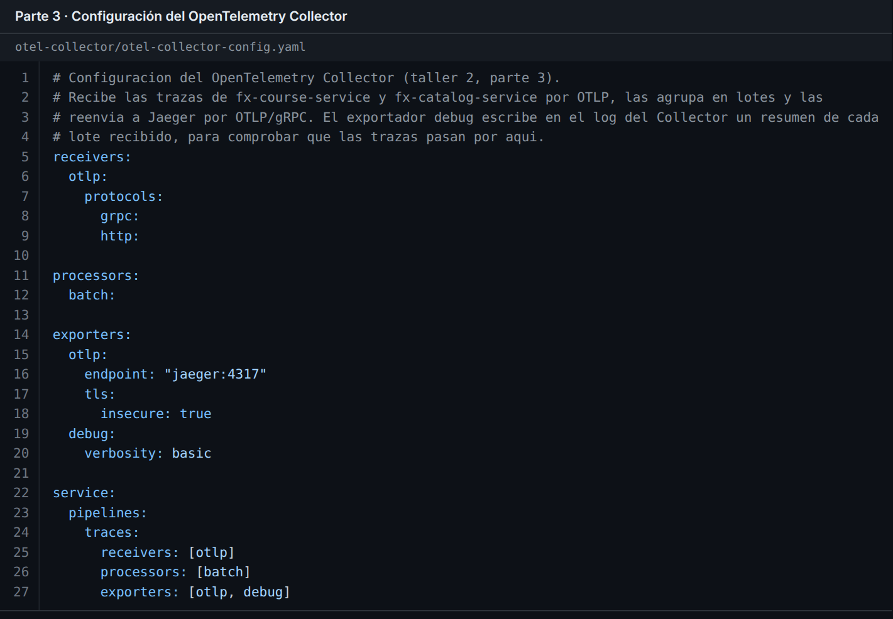

### 2. `docker-compose.yml`

Se agregó el servicio `otel-collector` (imagen `otel/opentelemetry-collector:0.88.0`) con el archivo de
configuración montado y sus receptores publicados en los puertos 4319 (gRPC) y 4320 (HTTP) del host. Los
servicios ahora dependen del Collector y exportan a `http://otel-collector:4317`.

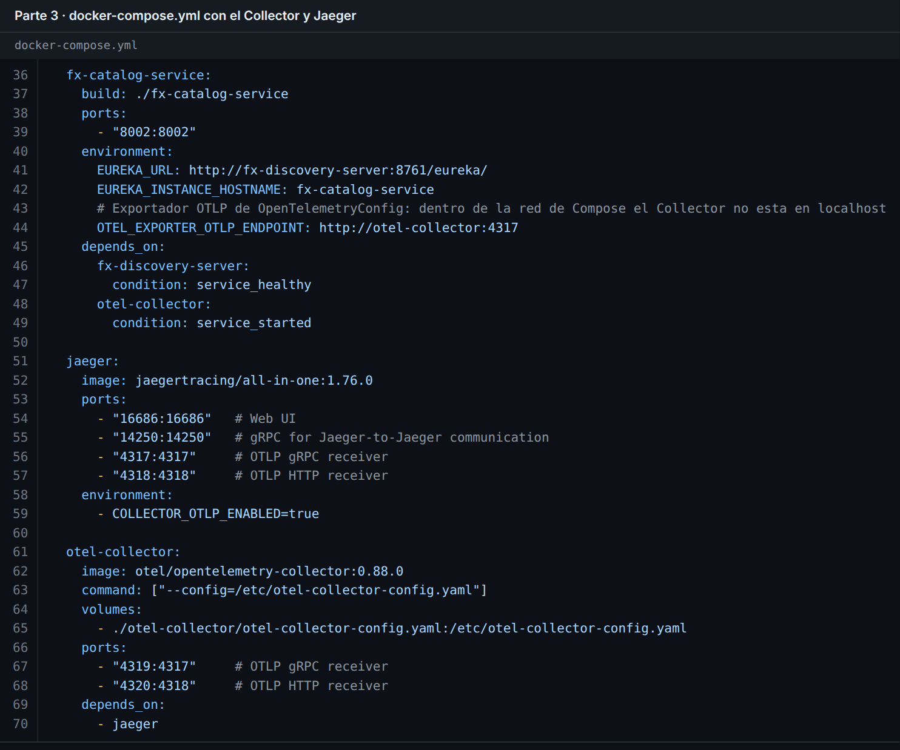

### 3. `application.properties`

Se agregaron las propiedades `otel.*` de la guía, con el endpoint del Collector publicado en el host
(`http://localhost:4319`). Dentro de Compose, la variable `OTEL_EXPORTER_OTLP_ENDPOINT` lo reemplaza por
`http://otel-collector:4317`.

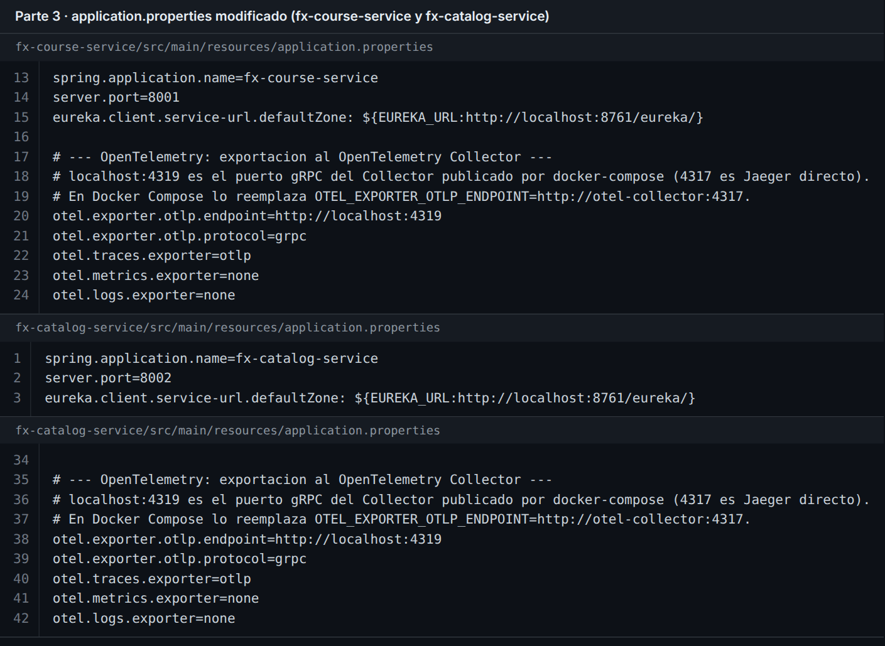

### 4. `OpenTelemetryConfig` actualizado

El cambio de la guía consiste en reemplazar `ContextPropagators.noop()` por el propagador W3C Trace Context. El
endpoint del exportador se toma ahora de `otel.exporter.otlp.endpoint`.

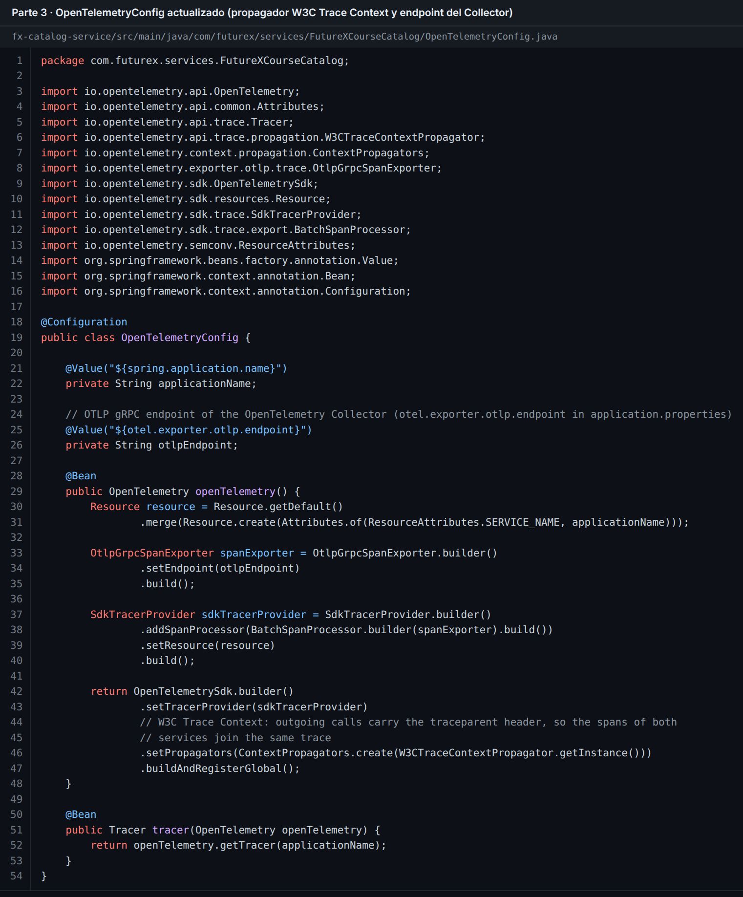

### 5. Ejecución y trazas en Jaeger a través del Collector

Los cinco contenedores quedan en ejecución, el catálogo exporta a `otel-collector:4317` y el log del Collector
registra cada lote reenviado a Jaeger (`TracesExporter` del exportador `debug`):

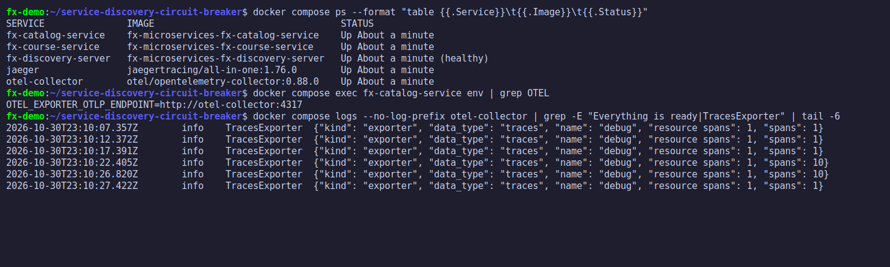

Con el propagador W3C, la llamada del catálogo lleva la cabecera `traceparent` y una petición produce una sola
traza con los spans de ambos servicios, incluidos los manuales: `GET /catalog` → `getCatalog` → `GET` →
`GET /courses` → `getCourses` → conexión y consulta SQL.

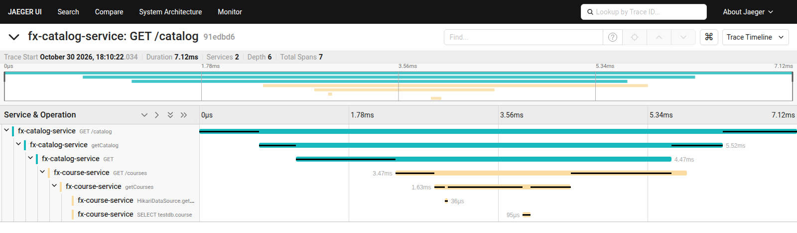

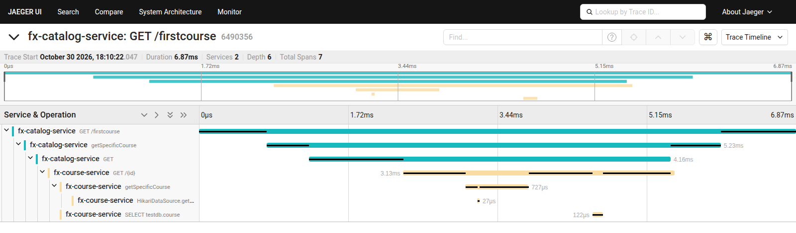

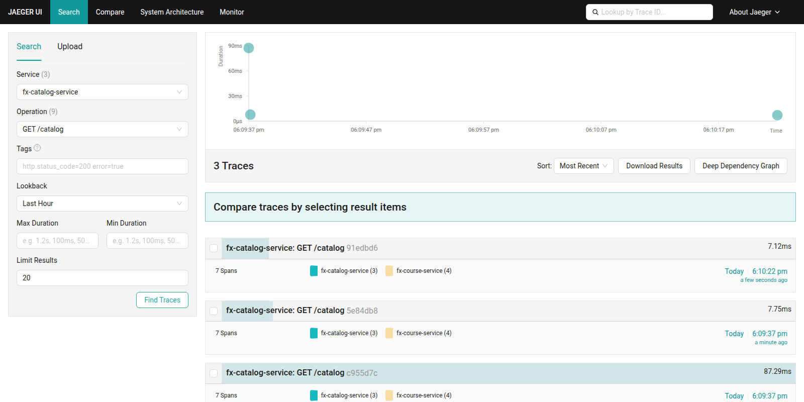

La vista *System Architecture* de Jaeger, construida a partir de las relaciones entre spans, muestra la
dependencia `fx-catalog-service → fx-course-service`, que en la parte 2 no podía reconstruirse:

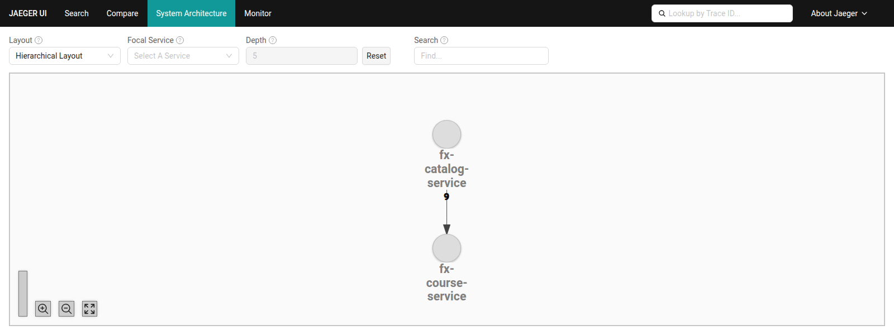

### Problemas encontrados y soluciones

- **En la guía, las trazas no pasan por el Collector.** La guía publica el Collector en los puertos 4319/4320,
  pero su `application.properties` y su `OpenTelemetryConfig` siguen apuntando a `localhost:4317`, que es el
  receptor de Jaeger: las aplicaciones seguirían enviando directamente a Jaeger. *Solución:* apuntar a
  `localhost:4319` en local y a `otel-collector:4317` en Compose. El log del Collector confirma el recorrido.
- **Evidencia del paso por el Collector.** Jaeger no distingue entre una traza recibida directamente y otra
  reenviada por el Collector. *Solución:* el exportador `debug` del Collector y la variable de entorno de los
  contenedores.
- **Propiedades no utilizadas.** La guía incluye `course.service.url` y
  `spring.main.allow-bean-definition-overriding=true`. No se agregaron: el catálogo localiza al servicio de cursos
  con Eureka, y el starter no entra en conflicto con el bean propio.
- **Versión del Collector.** Se mantuvo la 0.88.0 de la guía. En esa versión el receptor OTLP escucha en
  `0.0.0.0` por defecto; a partir de la 0.104 escucha en `localhost`, y habría que declarar
  `endpoint: 0.0.0.0:4317` para que los otros contenedores lo alcancen.

---

## Comparación de los enfoques

| | Parte 1: agente Java | Parte 2: API/SDK | Parte 3: API/SDK + Collector |
|---|---|---|---|
| Cambios en el código | Ninguno (Dockerfile y configuración) | Dependencias, `OpenTelemetryConfig`, controladores | Los de la parte 2 + configuración del Collector |
| Instrumentación automática | Amplia (HTTP, JPA, Hibernate, JDBC) | La del starter (Spring MVC, `RestTemplate`, JDBC) | Igual que la parte 2 |
| Spans de negocio | No | Sí (spans manuales con atributos y eventos) | Sí |
| Traza entre servicios | Sí (W3C por defecto) | No (`noop`: una traza por servicio) | Sí (W3C) |
| Destino | Jaeger | Jaeger | Collector → Jaeger |
| Desacople del backend | No | No | Sí: cambiar de backend solo requiere modificar el Collector |

Se integró en `main` la rama `otel-colector` por las siguientes razones:

- Reúne las partes 2 y 3: dependencias, configuración del SDK, spans manuales y propagación del contexto.
- Produce trazas completas entre servicios, con los spans de negocio de los dos controladores.
- El Collector desacopla las aplicaciones del backend de trazas: el procesamiento por lotes, el filtrado, el
  enriquecimiento o el envío a otros destinos se configuran en un solo lugar, sin recompilar los servicios.
- Deja una base preparada para los próximos talleres, por ejemplo para agregar métricas o logs al mismo Collector.

El agente Java produce la instrumentación automática más amplia sin tocar el código y sigue disponible en la rama
`otel-agente-java`. Sin embargo, no se puede combinar con la configuración de la parte 2 en la misma JVM, porque
ambos registran un `OpenTelemetry` global.

## Resumen de problemas y soluciones

| Parte | Problema | Solución |
|---|---|---|
| 1 | El agente ignora `application.properties` | `-Dotel.javaagent.configuration-file` |
| 1 | `localhost` dentro de Docker | `OTEL_EXPORTER_OTLP_ENDPOINT=http://jaeger:4317` |
| 1 | Trazas del cliente de Eureka cada 5 s | Filtrar por operación en Jaeger |
| 2 | El controlador de la guía elimina Eureka y Resilience4j | Instrumentar el controlador existente |
| 2 | Spans manuales sin hijos | `span.makeCurrent()` |
| 2 | `GlobalOpenTelemetry.set has already been called` en pruebas | `GlobalOpenTelemetry.resetForTest()` en `@BeforeAll` |
| 2 | Endpoint fijo en el código | Endpoint desde la configuración |
| 2 | Trazas separadas por servicio | Consecuencia esperada de `noop`; se resuelve en la parte 3 |
| 3 | Las aplicaciones de la guía apuntan a Jaeger, no al Collector | `localhost:4319` / `otel-collector:4317` |
| 3 | Demostrar el paso por el Collector | Exportador `debug` |
