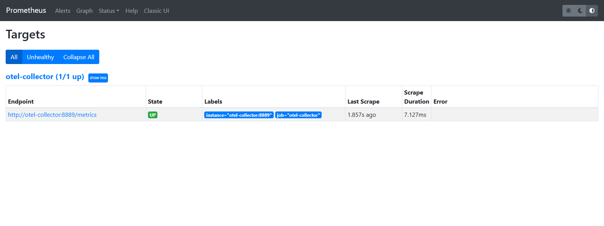
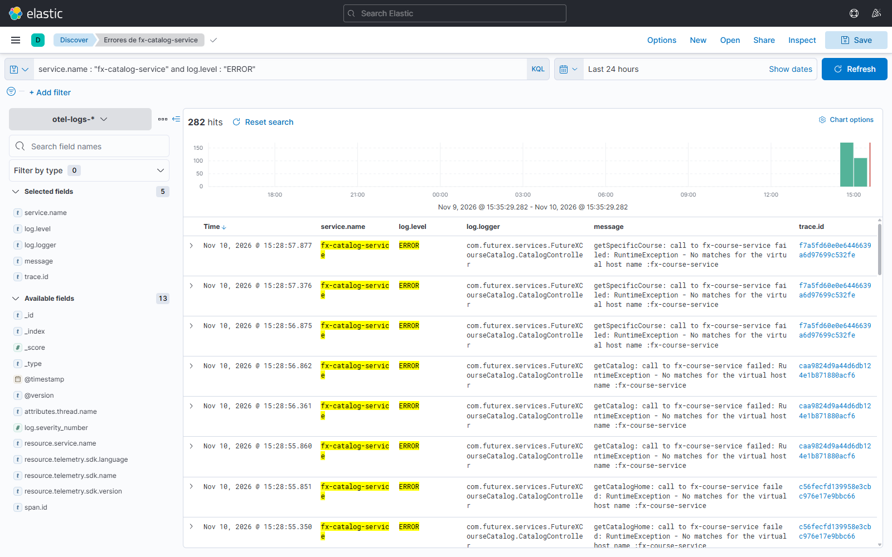
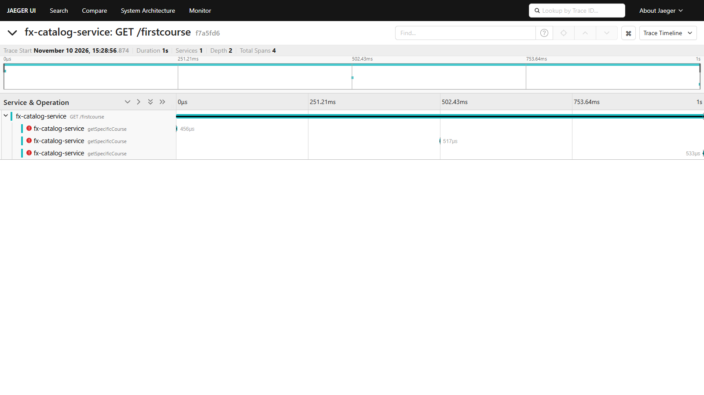
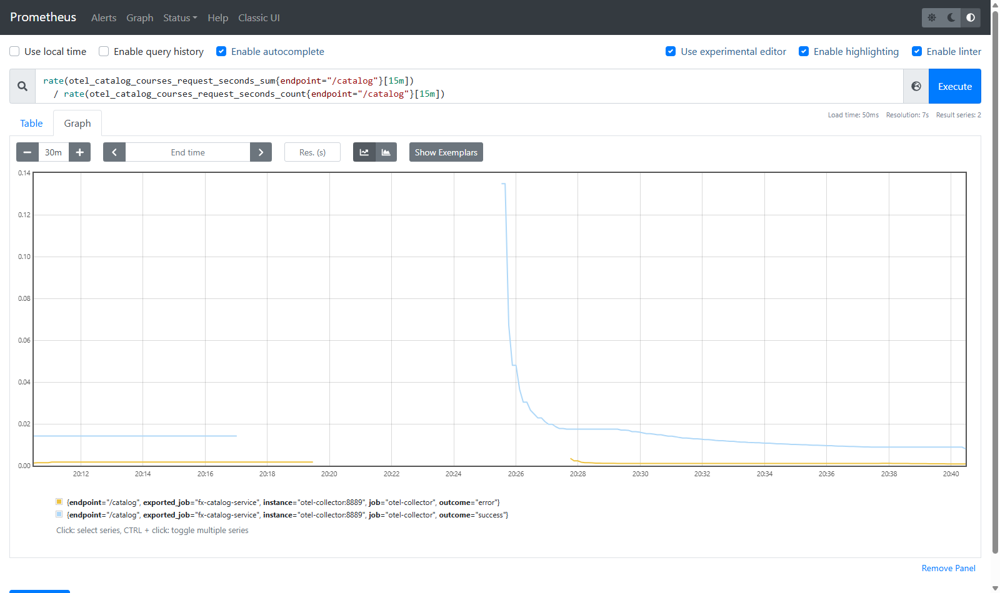
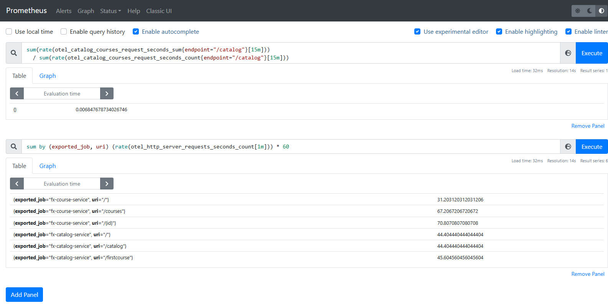
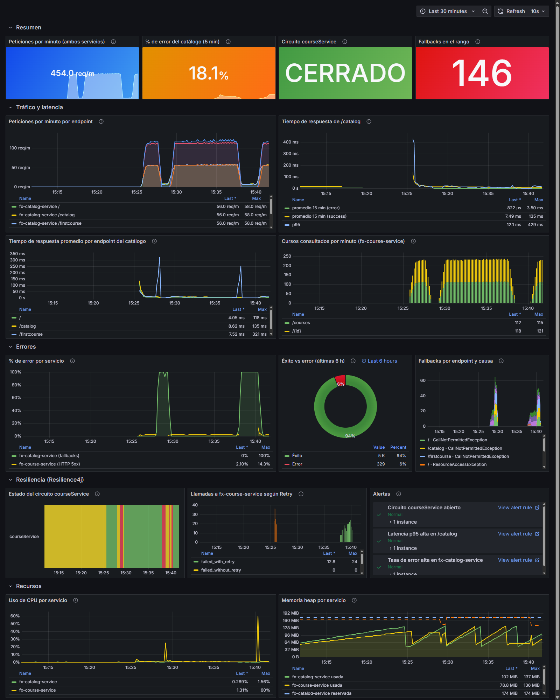
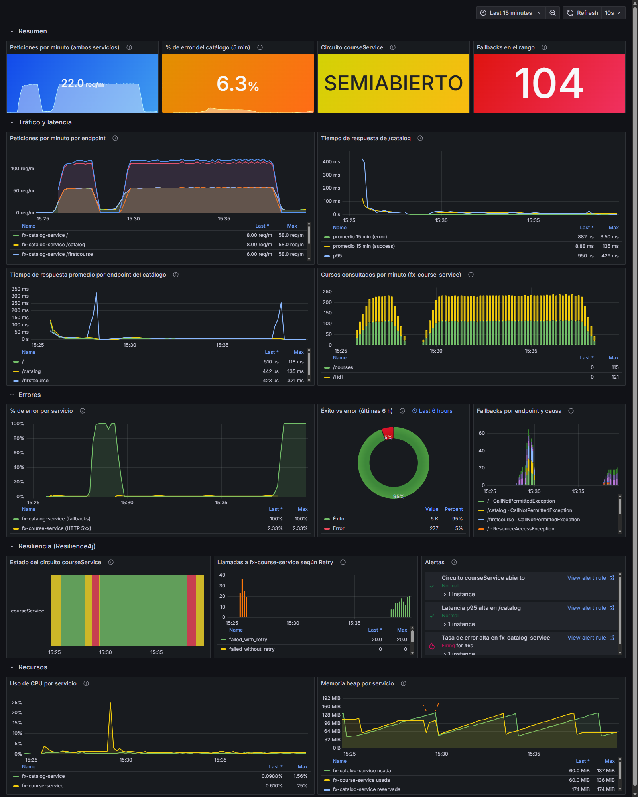
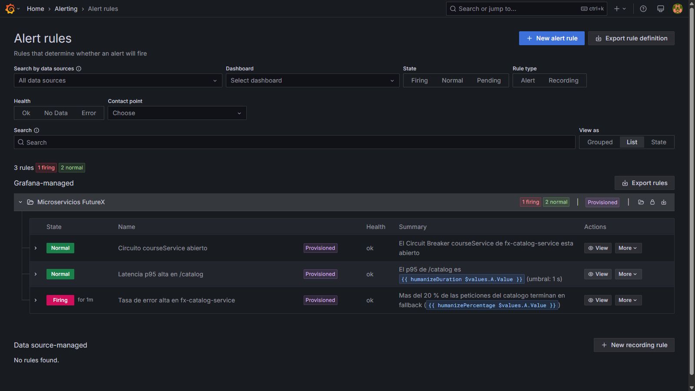
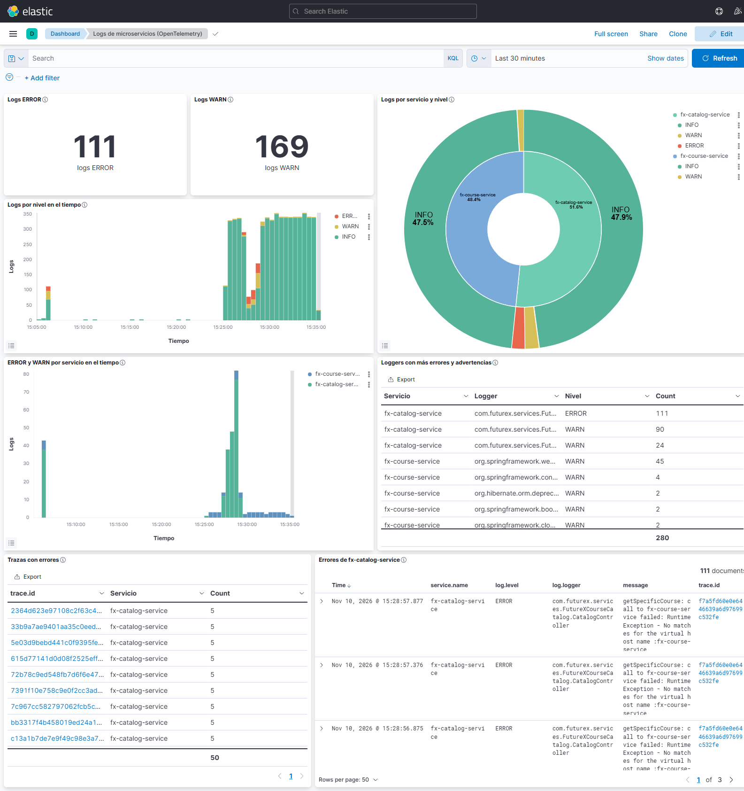

# Monitoreo y Observabilidad con OpenTelemetry Collector

**Integrantes:** Juan Camilo Muñoz Barco y Martin Gomez Caicedo
**Repositorio:** https://github.com/Electromayonaise/service-discovery-circuit-breaker

Este informe documenta el taller 4 de monitoreo y observabilidad sobre los microservicios `fx-course-service`
(FutureXCourseApp) y `fx-catalog-service` (FutureXCourseCatalog). La primera parte describe la implementación de la
guía *"Configuración de Observabilidad con OpenTelemetry Collector"*: métricas en Prometheus y Grafana, logs en
Elasticsearch y Kibana, y trazas en Jaeger, todo a través del Collector. La segunda parte presenta las consultas y
visualizaciones que pide el taller, cada una con su explicación y evidencia. También incluye dos extras: alertas en
Grafana y un dashboard de Kibana.

## Correspondencia con la rúbrica

| Criterio | Dónde se cubre |
|---|---|
| **1. Implementación (40 %)** | |
| Configuración de la infraestructura (Docker, servicios) | Parte 1, sección 5: los contenedores, sus puertos y el orden de arranque |
| Instrumentación de los microservicios | Parte 1, sección 2: proveedores de OpenTelemetry, appender de Logback y métricas propias |
| Exportación de métricas, logs y trazas | Parte 1, secciones 1, 3 y 4 (cada pipeline); sección 6 (verificación de las tres señales) |
| **2. Consultas y visualizaciones (60 %)** | |
| Consulta ELK: correctitud y relevancia | Parte 2, "Consulta ELK": KQL y Query DSL, campos, resultados y correlación con Jaeger |
| Consulta Prometheus: correctitud y relevancia | Parte 2, "Consulta Prometheus": cómo se calcula, una serie por `outcome` y el valor agregado |
| Gráfico en Grafana: diseño, claridad y relevancia | Parte 2, "Grafana": 16 paneles en 5 filas, en estado normal y durante una caída |
| **Extras** | Alertas de Grafana y dashboard de Kibana |

El código fuente está en el repositorio; cada sección enlaza los archivos que describe.

## Contexto

Los servicios vienen de los talleres anteriores:

- `fx-catalog-service` descubre a `fx-course-service` a través de Eureka (`fx-discovery-server`).
- Las llamadas entre los dos están protegidas con Resilience4j (Circuit Breaker `courseService`, Retry de 3
  intentos y fallbacks).
- En el taller 2 se instrumentaron con la API de OpenTelemetry y se enviaron las trazas a Jaeger a través del
  Collector (rama `otel-colector`, integrada en `main`).

Este taller parte de ese estado y agrega las otras dos señales, métricas y logs.

```text
fx-course-service ─┐                     ┌─ trazas   → Jaeger                                  :16686
                   ├─ OTLP → Collector ──┼─ métricas → :8889/metrics → Prometheus :9090 → Grafana :3000
fx-catalog-service ┘                     └─ logs     → logs/otel-collector.log → Logstash → Elasticsearch :9200 → Kibana :5601
```

Versiones utilizadas:

- Spring Boot 3.3.3, OpenTelemetry SDK 1.40.0 (`opentelemetry-instrumentation-bom` 2.6.0).
- `otel/opentelemetry-collector` 0.88.0 y Prometheus v2.30.3, los de la guía.
- Grafana 11.6.0 y Elasticsearch, Logstash y Kibana 7.17.28. Son más nuevas que las de la guía (Grafana 8.1.2,
  ELK 7.14.0) porque esas tienen vulnerabilidades conocidas:
  - Grafana 8.1.2: *path traversal* sin autenticación (CVE-2021-43798);
  - ELK 7.14.0: Log4Shell.

---

## Parte 1: Implementación (guía 3)

### 1. Pipelines del Collector

[otel-collector-config.yaml](../../otel-collector/otel-collector-config.yaml) recibe las tres señales por OTLP
(gRPC 4317 y HTTP 4318), las agrupa con el procesador `batch` y las reparte en tres pipelines:

| Pipeline | Exportadores | Destino |
|---|---|---|
| `traces` | `otlp`, `debug` | Jaeger (`jaeger:4317`), igual que en el taller 2 |
| `metrics` | `prometheus`, `debug` | Endpoint `/metrics` en el puerto 8889, con el prefijo `otel_` |
| `logs` | `file`, `debug` | `/var/log/otel-collector.log`, montado en `./logs` y leído por Logstash |

En lugar del exportador `logging` de la guía se usa `debug`, porque en la versión 0.88.0 `logging` está deprecado.

### 2. Instrumentación de los servicios

- **`OpenTelemetryConfig`** registra, además del `TracerProvider`, un `MeterProvider` y un `LoggerProvider` que
  exportan por OTLP al Collector.
- **Logs**: [logback-spring.xml](../../fx-catalog-service/src/main/resources/logback-spring.xml) agrega el
  `OpenTelemetryAppender`. Cada log sale por OTLP con el `trace_id` y el `span_id` de la petición en curso, y eso
  permite pasar de un log a su traza.
- **Métricas de plataforma**: `spring-boot-starter-actuator` y `micrometer-registry-otlp` exportan las métricas de
  Spring MVC (`http.server.requests`), la JVM, el proceso y Resilience4j.
- **Métricas propias** (Micrometer, en los controladores):

  | Métrica | Tipo | Etiquetas | Servicio |
  |---|---|---|---|
  | `catalog.home.request`, `catalog.courses.request`, `catalog.firstcourse.request` | Timer (con histograma) | `endpoint`, `outcome` = `success`/`error` | catálogo |
  | `catalog.fallback` | Counter | `endpoint`, `cause` (excepción que provocó el fallback) | catálogo |
  | `courses.accessed` | Counter | `endpoint` | cursos |

En Prometheus las métricas llevan el prefijo `otel_` y el servicio que las produjo va en la etiqueta
`exported_job`. Por ejemplo, `catalog.courses.request` se convierte en
`otel_catalog_courses_request_seconds_{sum,count,bucket}{exported_job="fx-catalog-service", endpoint="/catalog", outcome="success"}`.

### 3. Prometheus y Grafana

- **Prometheus** ([prometheus.yml](../../observability/prometheus/prometheus.yml)) scrapea `otel-collector:8889`
  cada 10 s.
- **Grafana** se configura entero por *provisioning*, sin pasos manuales en la interfaz:
  - fuente de datos Prometheus: [datasources/prometheus.yml](../../observability/grafana/provisioning/datasources/prometheus.yml);
  - proveedor de dashboards: [dashboards/dashboards.yml](../../observability/grafana/provisioning/dashboards/dashboards.yml);
  - el dashboard: [fx-observabilidad.json](../../observability/grafana/provisioning/dashboards/json/fx-observabilidad.json);
  - las reglas de alerta: [alert-rules.yml](../../observability/grafana/provisioning/alerting/alert-rules.yml).



### 4. Logstash, Elasticsearch y Kibana

[logstash.conf](../../observability/logstash/logstash.conf) lee el archivo del Collector y guarda los documentos en
el índice diario `otel-logs-AAAA.MM.DD`. Hay dos diferencias con la guía:

- **Un documento por log.** Cada línea del archivo es un lote OTLP completo (`resourceLogs → scopeLogs →
  logRecords`), con muchos logs. Con solo el filtro `json` de la guía, cada lote quedaría como un único documento
  con arreglos anidados, y no se podría filtrar por servicio ni por nivel. El script
  [otlp_logs.rb](../../observability/logstash/otlp_logs.rb) separa el lote y deja en cada documento:
  - `@timestamp` (tomado del `timeUnixNano` del log, no de la hora de lectura) y `message`;
  - `log.level`, `log.severity_number`, `log.logger`;
  - `service.name`, `trace.id`, `span.id`;
  - `attributes.*` y `resource.*`.

  El id del documento se deriva del contenido de la línea, así que volver a leer el archivo no duplica documentos.
- **Plantilla de índice.** [otel-logs-template.json](../../observability/logstash/otel-logs-template.json) define
  `service.name`, `log.level`, `trace.id`, etc. como `keyword`, para poder filtrar y agregar por ellos sin el
  sufijo `.keyword`. También deja las réplicas en 0: con un solo nodo, el índice queda en verde.

Los objetos de Kibana (patrón de índice, búsquedas, visualizaciones y dashboard) están versionados en
[kibana-objects.ndjson](../../observability/kibana/kibana-objects.ndjson). El contenedor `kibana-setup` los importa
al arrancar con [kibana-setup.sh](../../observability/kibana/kibana-setup.sh) mediante la API de *saved objects*.

### 5. Infraestructura, ejecución y generación de tráfico

[docker-compose.yml](../../docker-compose.yml) define todo el entorno:

| Contenedor | Imagen | Puerto en el host | Función |
|---|---|---|---|
| `fx-discovery-server` | build local | 8761 | Eureka |
| `fx-course-service` | build local | 8001 | Servicio de cursos |
| `fx-catalog-service` | build local | 8002 | Catálogo, cliente de cursos con Resilience4j |
| `otel-collector` | `otel/opentelemetry-collector:0.88.0` | 4319/4320 (OTLP), 8889 (métricas) | Recibe las tres señales y las reparte |
| `jaeger` | `jaegertracing/all-in-one:1.76.0` | 16686 | Trazas |
| `prometheus` | `prom/prometheus:v2.30.3` | 9090 | Almacena las métricas que expone el Collector |
| `grafana` | `grafana/grafana:11.6.0` | 3000 | Dashboard y alertas, por provisioning |
| `elasticsearch` | `elasticsearch:7.17.28` | 9200 | Almacena los logs (un nodo) |
| `logstash` | `logstash:7.17.28` | 5044, 9600 | Lee el archivo de logs del Collector y lo indexa |
| `kibana` | `kibana:7.17.28` | 5601 | Consulta y dashboard de logs |
| `kibana-setup` | `curlimages/curl:8.10.1` | — | Importa los objetos de Kibana y termina |
| `trafico` | `curlimages/curl:8.10.1` | — | Generador de carga (perfil `trafico`, opcional) |

- **Orden de arranque.** Lo controlan `depends_on` y los *healthchecks*:
  - los servicios esperan a que Eureka esté sano;
  - Logstash y Kibana esperan a Elasticsearch;
  - `kibana-setup` espera a Kibana.
- **Configuración por variables de entorno.** Los servicios reciben así la URL de Eureka y del Collector.
- **Acceso solo local.** Las herramientas de observabilidad escuchan únicamente en `127.0.0.1`, porque no tienen
  autenticación o usan `admin/admin`.

```bash
docker compose up --build -d                       # servicios, Collector, Jaeger, Prometheus, Grafana, ELK y kibana-setup
docker compose --profile trafico up -d trafico     # tráfico continuo contra los dos servicios
docker compose stop fx-course-service              # simular la caída del servicio de cursos (y luego: start)
```

El contenedor `trafico` ([generar-trafico.sh](../../observability/trafico/generar-trafico.sh)) llama una vez por
segundo a `/`, `/catalog` y `/firstcourse` del catálogo, y a `/courses` y `/{id}` del servicio de cursos. Uno de
cada diez ciclos pide `/99`, un curso que no existe y que responde HTTP 500. Las gráficas siguientes se tomaron con
este tráfico y con dos caídas simuladas de `fx-course-service` (hacia las 15:27 y de 15:37 a 15:40).

### 6. Verificación de la exportación

Al cierre de la prueba, cada herramienta tenía datos de los dos servicios:

| Señal | Comprobación | Resultado |
|---|---|---|
| Trazas | `GET http://localhost:16686/api/services` en Jaeger | `fx-catalog-service` y `fx-course-service` |
| | Operaciones de `fx-catalog-service` | Spans de servidor (`GET /`, `GET /catalog`, `GET /firstcourse`), spans manuales (`getCatalog`, `getCatalogHome`, `getSpecificCourse`) y spans de cliente HTTP |
| Métricas | Target `otel-collector:8889` en Prometheus | `UP` (captura de la sección 3) |
| | `count by (exported_job) ({__name__=~"otel_.+", exported_job=~"fx-.+"})` | 992 series de `fx-catalog-service` y 580 de `fx-course-service`, en 115 métricas distintas |
| Logs | Agregación por `service.name` y `log.level` en `otel-logs-*` | 19 590 documentos |
| | `fx-catalog-service` | 10 357 documentos: 9 564 INFO, 361 WARN, 432 ERROR |
| | `fx-course-service` | 9 233 documentos: 9 054 INFO, 179 WARN |

La captura de Jaeger de la parte 2 muestra además que los logs y las trazas están conectados: el `trace.id` de un
log en Kibana abre la traza correspondiente.

---

## Parte 2: Consultas y visualizaciones

### Consulta ELK: errores de `fx-catalog-service` en las últimas 24 horas

En Kibana (Discover), con el patrón de índice `otel-logs-*` y el rango de tiempo **Last 24 hours**:

```text
service.name : "fx-catalog-service" and log.level : "ERROR"
```

- `service.name` viene del recurso OTLP: es el `service.name` que configura `OpenTelemetryConfig`.
- `log.level` es el `severityText` del log, que el appender de Logback rellena con el nivel (`ERROR`, `WARN`,
  `INFO`).
- El rango de 24 horas se aplica sobre `@timestamp`, que es el campo de tiempo del patrón de índice.

La misma consulta en Query DSL contra Elasticsearch, donde el rango de tiempo queda explícito en `@timestamp`:

```http
GET otel-logs-*/_search
{
  "track_total_hits": true,
  "sort": [{ "@timestamp": "desc" }],
  "query": {
    "bool": {
      "filter": [
        { "term":  { "service.name": "fx-catalog-service" } },
        { "term":  { "log.level": "ERROR" } },
        { "range": { "@timestamp": { "gte": "now-24h" } } }
      ]
    }
  }
}
```

La consulta se guardó en Kibana como la búsqueda **"Errores de fx-catalog-service"**. Devuelve los logs que escribe
el catálogo cuando falla una llamada a `fx-course-service`. El mensaje indica el endpoint y la causa, por ejemplo
`getCatalog: call to fx-course-service failed: RuntimeException - No matches for the virtual host name
:fx-course-service`: Eureka no tiene instancias registradas porque el servicio está caído. Al cierre de la prueba
la consulta DSL devolvía 432 documentos, repartidos en `getCatalog` (213), `getCatalogHome` (111) y
`getSpecificCourse` (108).



**Correlación con las trazas.** En el patrón de índice, el campo `trace.id` tiene formato URL
(`http://localhost:16686/trace/{{value}}`). Al hacer clic en él desde un log se abre la traza de esa petición en
Jaeger. El log de la captura anterior pertenece a esta traza de `GET /firstcourse`. Los tres spans
`getSpecificCourse` con error, separados 500 ms, son los tres intentos del Retry de Resilience4j antes de responder
con el fallback:



### Consulta Prometheus: tiempo de respuesta promedio de `/catalog` en los últimos 15 minutos

```promql
rate(otel_catalog_courses_request_seconds_sum{endpoint="/catalog"}[15m])
  / rate(otel_catalog_courses_request_seconds_count{endpoint="/catalog"}[15m])
```

- `otel_catalog_courses_request_seconds` es el Timer de Micrometer que envuelve el endpoint `/catalog`. Prometheus
  lo expone como `_sum` (segundos acumulados) y `_count` (cantidad de peticiones).
- `rate(...[15m])` calcula el ritmo de crecimiento por segundo de cada contador en los últimos 15 minutos. Dividir
  los segundos por segundo entre las peticiones por segundo da la duración promedio por petición en esa ventana.
  Así se compensan los reinicios de los contadores y no se depende del valor absoluto acumulado.
- La consulta devuelve una serie por valor de `outcome`. Las peticiones que terminan en fallback (`error`) se
  promedian aparte de las exitosas (`success`), y así una caída de `fx-course-service` no esconde la latencia real
  del caso normal.



En la gráfica:

- el pico de `success` a la izquierda corresponde al arranque, cuando las primeras peticiones incluyen la
  inicialización de Eureka y del cliente HTTP;
- después baja a unos 8–10 ms;
- las respuestas `error` (fallback) tardan menos de 1 ms, porque con el circuito abierto ni siquiera se llama al
  servicio.

Para obtener un único número, como pide el ejemplo del taller, se suman las series antes de dividir. El resultado
fue de 0,0068 s, es decir **6,8 ms**:

```promql
sum(rate(otel_catalog_courses_request_seconds_sum{endpoint="/catalog"}[15m]))
  / sum(rate(otel_catalog_courses_request_seconds_count{endpoint="/catalog"}[15m]))
```



### Grafana: dashboard "Microservicios FutureX — Observabilidad"

El dashboard (carpeta *Microservicios FutureX*, http://localhost:3000/d/fx-observabilidad) se carga por
provisioning y se refresca cada 10 s. Tiene 16 paneles en cinco filas. Incluye los tres ejemplos del taller:
peticiones por minuto por endpoint, CPU y memoria, y % de error frente a éxito en 6 h.

| Fila | Panel | Consulta (resumida) | Qué muestra |
|---|---|---|---|
| Resumen | Peticiones por minuto | `sum(rate(otel_http_server_requests_seconds_count[$__rate_interval])) * 60` | Carga total de los dos servicios |
| | % de error del catálogo (5 min) | `sum(rate(otel_catalog_fallback_total[5m])) / sum(rate(otel_http_server_requests_seconds_count{exported_job="fx-catalog-service"}[5m]))` | Fracción de respuestas que fueron fallback |
| | Circuito courseService | `max(...state="half_open") + 2 * max(...state=~"open\|forced_open")` | 0 = CERRADO, 1 = SEMIABIERTO, 2 = ABIERTO |
| | Fallbacks en el rango | `sum(increase(otel_catalog_fallback_total[$__range]))` | Respuestas de respaldo en el rango elegido |
| Tráfico y latencia | **Peticiones por minuto por endpoint** | `sum by (exported_job, uri) (rate(otel_http_server_requests_seconds_count[$__rate_interval])) * 60` | Una serie por servicio y endpoint |
| | **Tiempo de respuesta de /catalog** | La consulta de 15 min de la sección anterior, más `histogram_quantile(0.95, ...)` | Promedio por `outcome` y percentil 95 |
| | Tiempo de respuesta por endpoint del catálogo | `rate({__name__=~"otel_catalog_.+_request_seconds_sum"}) / rate(..._count)` | Compara `/`, `/catalog` y `/firstcourse` |
| | Cursos consultados por minuto | `sum by (endpoint) (increase(otel_courses_accessed_total[1m]))` | Uso de `/courses` y `/{id}` |
| Errores | **% de error por servicio** | catálogo: fallbacks / peticiones; cursos: `outcome="SERVER_ERROR"` / peticiones | Tasa de error en el tiempo |
| | **Éxito vs error (últimas 6 h)** | `increase(...[$__range])` con el rango del panel fijado en 6 h | Torta de peticiones exitosas y fallidas |
| | Fallbacks por endpoint y causa | `sum by (endpoint, cause) (increase(otel_catalog_fallback_total[1m]))` | Si el fallo fue por circuito abierto (`CallNotPermittedException`) o por error de la llamada |
| Resiliencia | Estado del circuito | La misma expresión del estado, en un *state timeline* | Historia de CERRADO / SEMIABIERTO / ABIERTO |
| | Llamadas según Retry | `sum by (kind) (increase(otel_resilience4j_retry_calls_total[1m]))` | Llamadas exitosas, reintentadas o fallidas tras reintentar |
| | Alertas | Panel *alert list* | Estado de las tres reglas de alerta |
| Recursos | **Uso de CPU por servicio** | `otel_process_cpu_usage` | CPU del proceso Java de cada servicio |
| | **Memoria heap por servicio** | `sum by (exported_job) (otel_jvm_memory_used_bytes{area="heap"})` y `..._committed_bytes` | Heap usada (línea) y reservada (punteada) |

**Por qué el % de error no usa el código HTTP.** Los fallbacks del catálogo responden HTTP 200 con un mensaje de
respaldo. Por eso `status="500"` en `http_server_requests` solo cuenta los errores de `fx-course-service`, y para
el catálogo se usa el contador `otel_catalog_fallback_total`. En el servicio de cursos sí se usa
`outcome="SERVER_ERROR"`: `GET /99` responde 500.

Dashboard en estado normal (últimos 30 minutos):



Dashboard durante la caída simulada de `fx-course-service`, a partir de las 15:37:

- las peticiones por minuto de los dos servicios caen;
- el % de error del catálogo sube al 100 %, porque todas las respuestas son fallback;
- el circuito se abre (rojo) y luego pasa a SEMIABIERTO (amarillo);
- los fallbacks aparecen primero con causa `ResourceAccessException`, llamadas que fallan, y luego con
  `CallNotPermittedException`, cuando el circuito ya está abierto;
- el panel de alertas muestra la regla de tasa de error en *Firing*.



En la línea de tiempo del circuito, el tramo amarillo largo de 15:10 a 15:25 no es un error. Después de la primera
prueba el circuito quedó SEMIABIERTO, y en ese estado solo vuelve a CERRADO cuando las llamadas de prueba tienen
éxito. Como no hubo tráfico hasta que se arrancó el generador, permaneció así.

### Extra: alertas de Grafana

[alert-rules.yml](../../observability/grafana/provisioning/alerting/alert-rules.yml) define tres reglas. Se evalúan
cada 10 s, y cada una combina una consulta instantánea de Prometheus (A) con una condición de umbral (C):

| Regla | Consulta (A) | Condición | Espera (`for`) | Severidad |
|---|---|---|---|---|
| Circuito courseService abierto | `max(otel_resilience4j_circuitbreaker_state{name="courseService", state=~"open\|forced_open"})` | > 0 | 0 s | critical |
| Tasa de error alta en fx-catalog-service | `sum(rate(otel_catalog_fallback_total[1m])) / sum(rate(otel_http_server_requests_seconds_count{exported_job="fx-catalog-service"}[1m]))` | > 0,2 | 30 s | warning |
| Latencia p95 alta en /catalog | `histogram_quantile(0.95, sum by (le) (rate(otel_catalog_courses_request_seconds_bucket{endpoint="/catalog"}[1m])))` | > 1 s | 30 s | warning |

Comportamiento observado durante la caída:

- *Circuito courseService abierto* pasó a **Firing** en cuanto Resilience4j abrió el circuito. Volvió a *Normal*
  cuando el circuito pasó a SEMIABIERTO.
- *Tasa de error alta* estuvo 30 s en *Pending* y después pasó a **Firing**. Se mantuvo mientras el catálogo
  respondía con fallbacks.
- *Latencia p95 alta* no se disparó. Con el servicio caído, Eureka no tiene instancias y las llamadas fallan de
  inmediato, sin esperar el timeout de conexión. Esta regla detecta otro problema: un servicio lento, no caído.

`noDataState: OK` evita falsas alarmas mientras no hay tráfico. No se configuró un canal de notificación (correo,
Slack): el estado se ve en *Alerting → Alert rules* y en el panel *Alertas* del dashboard.



### Extra: visualizaciones y dashboard de Kibana

El dashboard **"Logs de microservicios (OpenTelemetry)"**
(http://localhost:5601/app/dashboards#/view/otel-dashboard-logs) se importa automáticamente y reúne:

| Visualización | Tipo | Configuración |
|---|---|---|
| Logs ERROR / Logs WARN | Metric | Conteo con `log.level : "ERROR"` y `log.level : "WARN"` |
| Logs por servicio y nivel | Pie (anillo doble) | Anillo interior: *terms* de `service.name`; anillo exterior: *terms* de `log.level` |
| Logs por nivel en el tiempo | Barras apiladas | *date histogram* de `@timestamp` dividido por `log.level`, con colores fijos por nivel |
| ERROR y WARN por servicio en el tiempo | Barras apiladas | *date histogram* dividido por `service.name`, filtrado a ERROR o WARN |
| Loggers con más errores y advertencias | Tabla | *terms* anidados `service.name → log.logger → log.level` |
| Trazas con errores | Tabla | *terms* de `trace.id` (enlace a Jaeger) y `service.name` |
| Errores de fx-catalog-service | Búsqueda guardada | La consulta ELK del taller |



En el dashboard se ven las dos caídas como picos de ERROR en el catálogo, que vienen de `CatalogController`. Los
WARN de `fx-course-service` son de `org.springframework.web` y corresponden a los `GET /99`. La tabla de trazas
muestra que cada traza con error tiene 5 logs: 3 de los intentos del Retry, 1 del fallback y 1 de la respuesta.

---

## Problemas encontrados y soluciones

- **`fx-course-service` no arrancaba al agregar `micrometer-registry-otlp`.** Le faltaba
  `spring-boot-starter-actuator`, que la guía pide en ambos servicios. Sin él no se autoconfigura el
  `MeterRegistry` que los controladores inyectan. *Solución:* agregar el actuator al `pom.xml`.
- **Los lotes OTLP llegaban a Elasticsearch como un solo documento.** *Solución:* el script `otlp_logs.rb`, que
  separa cada lote en un documento por log (ver la parte 1).
- **Campos mezclados entre logs al separar los lotes.** La primera versión tenía el código Ruby inline en el filtro
  `ruby`. Los workers del pipeline compartían ese contexto, y en 911 de 974 documentos se mezclaron campos de logs
  distintos o se repitieron ids.
  - *Solución:* mover el código a un archivo con `ruby { path => ... }`, donde cada evento usa variables locales.
  - El id se calcula con el SHA-1 de la línea más la posición del log dentro del lote.
  - Resultado: 974 de 974 documentos correctos.
- **Campos `text` en Elasticsearch.** Con el mapeo dinámico, `service.name` y `log.level` quedaban como `text` con
  subcampo `.keyword`, incómodos para filtrar y agregar. *Solución:* la plantilla `otel-logs-template.json`.
- **Errores del catálogo invisibles en las métricas HTTP.** Los fallbacks responden HTTP 200. *Solución:* la
  etiqueta `outcome` en los Timers y el contador `catalog.fallback`, que se usan para el % de error, la alerta y
  la torta de éxito/error.
- **`GET /99` no produce logs ERROR.** El 500 de `fx-course-service` lo registra Spring como `WARN`. Por eso la
  consulta ELK del taller apunta al catálogo, y el dashboard de Kibana muestra ERROR y WARN juntos.
- **La importación de Kibana reportaba éxito aunque fallara.** La API `_import` responde 200 aunque fallen
  objetos: un error de mapeo por usar `uiState` en lugar de `uiStateJSON` pasó desapercibido.
  - *Solución:* corregir el nombre del atributo.
  - Además, `kibana-setup.sh` ahora termina con error si la respuesta no trae `"success":true`.
- **Kibana no arrancaba al ocultar el banner de telemetría.** En 7.17,
  `TELEMETRY_ALLOWCHANGINGOPTINSTATUS=false` obliga a `telemetry.optIn=true`. *Solución:* dejar solo
  `TELEMETRY_OPTIN=false` y `XPACK_SECURITY_SHOWINSECURECLUSTERWARNING=false`.
- **Panel de alertas vacío en Grafana 11.** El filtro de estados incluía `recovering`, que esta versión no acepta
  ("unknown state 'recovering'"). *Solución:* quitarlo del JSON del dashboard.
- **% de error mayor que 100 %.** El cociente de dos `rate` con ventanas desfasadas llegó a 106 % durante la caída.
  *Solución:* `clamp_max(..., 1)` en el panel.
- **Dashboards sin datos sin intervención manual.** *Solución:* el contenedor `trafico`, que genera carga continua
  e incluye peticiones que fallan.

## Cómo reproducir

```bash
docker compose up --build -d
docker compose --profile trafico up -d trafico
# Grafana  http://localhost:3000  (admin / admin) → Dashboards → Microservicios FutureX
# Kibana   http://localhost:5601  → Dashboards → Logs de microservicios (OpenTelemetry)
docker compose stop fx-course-service     # provocar fallbacks, abrir el circuito y disparar las alertas
docker compose start fx-course-service    # recuperación
docker compose --profile trafico stop trafico
```
